  

# Jellyfish-to-Human: do the immortal jellyfish's expanded genes decline with age in human tissues?

The immortal jellyfish *Turritopsis dohrnii* can reverse its life cycle. Its genome carries extra copies or unique variants of genes for DNA replication, DNA repair, telomere protection, redox balance and stem-cell signalling (Pascual-Torner et al., *PNAS* 2022). We asked whether the **human versions** of these genes lose expression with age in human tissues more than expected by chance.

## Answer in one line
**No.** Across 46 human tissues from 971 donors, the jellyfish-expanded genes change with age no differently from matched random genes or from other genes with the same function.

## Design (decided before seeing the data)
| | |
|---|---|
| Gene set (Set A) | 22 human orthologs of *T. dohrnii* copy-number / variant genes named in PNAS 2022 |
| Data | GTEx v8 open access: 971 donors, 19,052 samples, 46 tissues, 19,208 protein-coding genes |
| Model | Per gene and tissue: log2(TPM+1) ~ age + sex + ischemic time + RIN + Hardy death scale |
| Score | Mean age t-value of Set A, averaged across tissues |
| Control 1 | 10,000 random sets matched for expression, gene length and GC content |
| Control 2 | 10,000 function-matched sets (same GO process: replication 135, repair 515, telomere 97, redox 42 genes) |
| Positive result | Beats both controls, p < 0.05 |

## Results
| Test | Set A | Control 1 | Control 2 |
|---|---|---|---|
| All 22 genes, mean age t | −0.003 | 37th percentile, p = 0.72 | 35th percentile, p = 0.70 |
| DNA-maintenance core (12 genes) | +0.077 | p = 0.84 | p = 0.88 |
| Tissues beating both controls (FDR < 0.05) | 0 of 46 | | |

**Pre-registered verdict: NULL.**

Exploratory only: Set A leaned downward in brain (cerebellum and frontal cortex, mean t ≈ −2.1) and whole blood, and upward in adipose and skeletal muscle, but none of these beat the controls. GenAge human ageing genes (298) were not distinctive either (mean t +0.09).

## Quality check
Genes known to rise with age in GTEx rose as expected (EDA2R up in 28 of 31 tissues, mean t +5.9; CDKN2A +4.4; C4A/C4B up), so the age coding is correct. The collagen "falls with age" check did not behave as assumed (collagens rose slightly in GTEx skin and arteries), so that arm of the check was a poor choice and is reported, not adjusted.

## Interpretation
The jellyfish's genome expansions do not mark a human tissue-ageing weakness at the expression level. Its rejuvenation likely depends on how and when these genes are used during life-cycle reversal, not on genes that human tissues lose with age.

## Limitations
- Set A comes from the PNAS 2022 main text; the paper's Dataset S1 may list more genes.
- Public GTEx gives age in 10-year groups; exact age is controlled access.
- Expression only; protein levels and DNA-repair activity were not measured.
- Cyst-stage jellyfish genes (Matsumoto & Miglietta, *GBE* 2021) were not tested because they lack reliable human orthologs.

## Related work
- Pascual-Torner M, et al. Comparative genomics of mortal and immortal cnidarians unveils novel keys behind rejuvenation. *PNAS* 119:e2118763119 (2022).
- Matsumoto Y, Miglietta MP. Cellular reprogramming and immortality. *Genome Biol Evol* 13(7):evab136 (2021).
- Takasugi M, et al. Gene expressions associated with longer lifespan and aging exhibit similarity in mammals. *Nucleic Acids Res* 51(14):7205 (2023).
- GTEx Consortium. *Science* 369:1318–1330 (2020).

## How to run
Open `notebooks/jellyfish_gtex_aging.ipynb` in Google Colab and choose **Runtime > Run all** (about 10–15 minutes). The executed run with all outputs is in `results/`.

## Author
Riddhika D, B.Tech Biotechnology, Sathyabama Institute of Science and Technology, Chennai, India.

Code: MIT licence.
